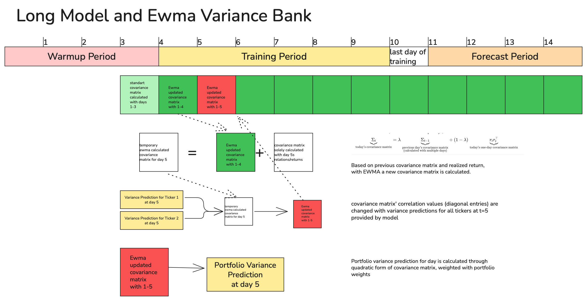
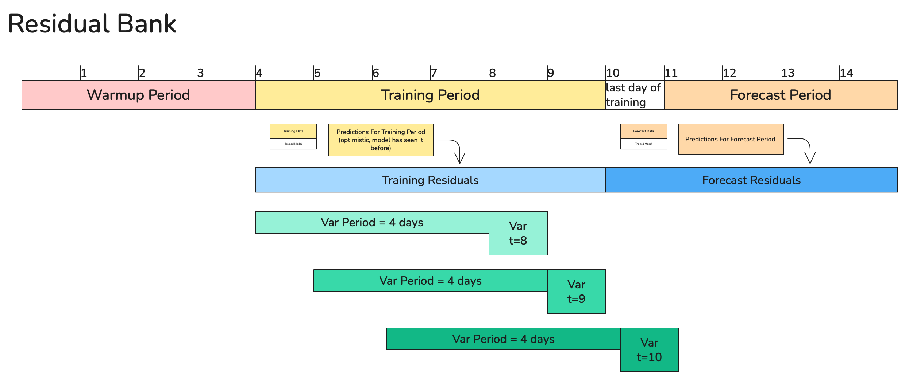
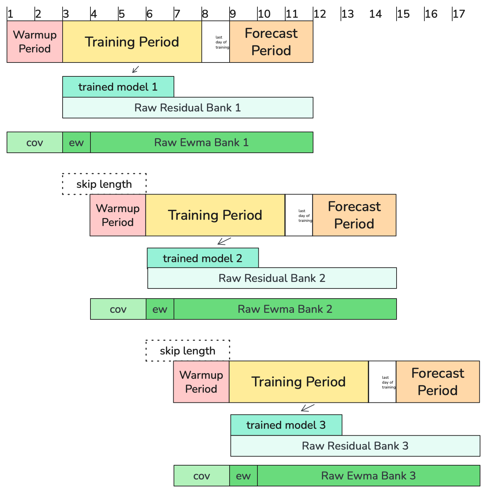
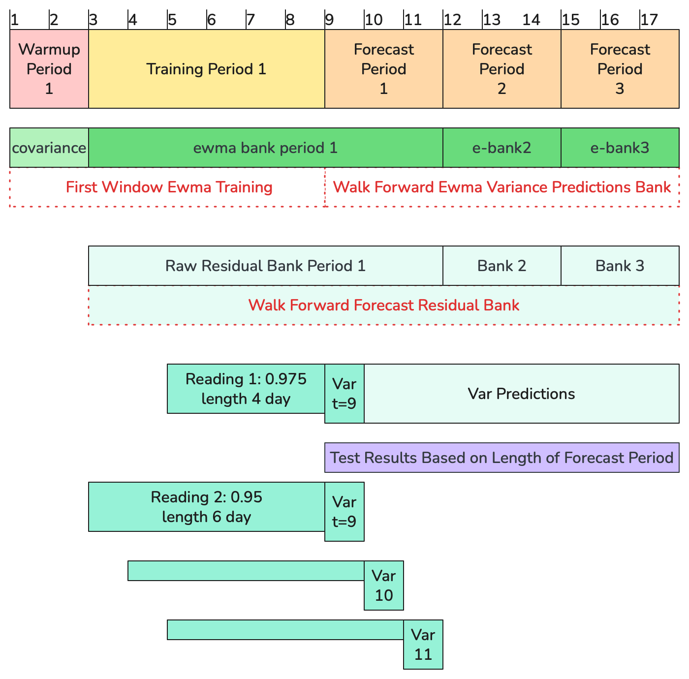

# VaR Forecasting with EWMA & GARCH

In this project, I covered different stages of the machine learning and research process.

The main goal of the project is to analyze daily return data for various U.S. stocks and estimate Value at Risk (VaR), with different portfolio weights.

I chose the Filtered Historical Simulation (FHS), inspired by the Python package ARCH and a course that demonstrated how to use the residuals of a GARCH estimation to derive the VaR. Hence, I always compare the models with GARCH to understand how much AI improves the results.

The target of the models is, as in GARCH, variance.

## Approach

Models could either see portfolio-based features in each row and predict the portfolio's own weighted variance, in the project called wide models.

Or they receive ticker-based features in each row, and their predictions are combined with the Exponentially Weighted Moving Average (EWMA), which proved to work better in later tests, called long models.

### Combining Variance Results with EWMA



For long models, an initial covariance matrix is estimated and subsequently updated over the entire observation period with the Exponentially Weighted Moving Average (EWMA) method. The matrix of day $t$ uses only returns before $t$:

$$
\Sigma_t = \lambda \Sigma_{t-1} + (1-\lambda) r_{t-1}r_{t-1}^{T}
$$

The EWMA matrix gives the **correlation structure** between the tickers. The **variance level** of every ticker comes from the model: the model's predicted variance $\hat\sigma^2_{i,t}$ of ticker $i$ for day $t$.

The EWMA covariance is turned into a correlation matrix and rescaled with the model's variances:

$$
R_t=D_t^{-1}\,\Sigma_t\,D_t^{-1},\qquad D_t=\mathrm{diag}\big(\sqrt{\Sigma_{t,11}},\dots,\sqrt{\Sigma_{t,nn}}\big)
$$

$$
\hat\Sigma_t = S_t R_t S_t,\qquad S_t=\mathrm{diag}\big(\hat\sigma_{1,t},\dots,\hat\sigma_{n,t}\big),
\qquad \hat\Sigma_{t,ij}=R_{t,ij}\,\hat\sigma_{i,t}\hat\sigma_{j,t}
$$

The diagonal of $\hat\Sigma_t$ is exactly the model variances ($R_{t,ii}=1$), and the off-diagonal elements are the EWMA correlations scaled to the model's volatilities.

Finally, $\hat\Sigma_t$ is combined with the portfolio weights through a weighted quadratic form to obtain the model's predicted portfolio variance:

$$ \boxed{\hat{\sigma}_{p,t}^{2}=\mathbf{w}^{T}\hat{\Sigma}_t\mathbf{w}} $$

The weights only enter in this last step: $\Sigma_t$ (and $R_t$) do not depend on them, so the same stored matrices can be read for other weights.

**Positive semi-definiteness.**
Overwriting the diagonal of $\Sigma_t$ with the model variances and leaving the off-diagonal elements as they are does not keep the matrix positive semi-definite (PSD), so it may not be a valid covariance matrix and $w^T\Sigma w$ can even become negative.

Because $R_t$ is a correlation matrix (PSD) and $S_t$ is a positive diagonal matrix, $\hat\Sigma_t=S_tR_tS_t$ is PSD for every day, so $w^T\hat\Sigma_t w\ge 0$ for any weights $w$.

**Variance floor.** A model variance below $10^{-12}$ (a tree model can output a value $\le 0$) is raised to $10^{-12}$ before $S_t$ is built, and the portfolio variance is floored the same way.

### VaR Calculation



For wide models, which predict the portfolio variance directly, as well as for GARCH and the results of long models, the output is converted into standardized residuals:

$$
\text{standardized\_residual}_t = \frac{\text{realized\_return}_t - \text{expected\_return}}{\sqrt{\text{predicted\_variance}_t}}
$$

The expected return is set to 0 by default. Alternatively, it can be estimated as a rolling mean of the realized returns over the last $N$ periods before the date.

After calculating the standardized residuals, the confidence level and lookback window setting are applied. For the prediction date $t$, the residuals of the $N$ days before $t$ are collected, and their lower-tail quantile at level $1-c$ (where $c$ is the confidence level) is taken. This quantile is then rescaled with the predicted volatility for date $t$ to obtain the VaR.

### Walk Forward



To evaluate model performance, the data is divided into chunks, each matching the chosen training and forecast period lengths. At each iteration, the training period shifts forward by the forecast-period length, generating consecutive, non-overlapping forecast periods.

At each iteration, separate residual and EWMA banks are created to store the estimated variances and their corresponding standardized residuals.



The forecast-period portions of the EWMA and residual banks from each iteration are then extracted and combined into a single walk-forward residual bank, which is subsequently used to generate VaR. VaR calculations in the walk-forward framework primarily use out-of-sample residuals, except for the first forecast period.

### Testing and Training Weights

$$ \boxed{\hat{\sigma}_{p,t}^{2}=\mathbf{w}_t^{T}\hat{\Sigma}_t\mathbf{w}_t} $$

With long models, the portfolio variance and covariance relations are not predicted directly but are later built using EWMA matrices, as described. But baseline models (see below) run in wide format, depend on portfolio returns, and must be recalculated.

The dashboard implements this recalculation of baseline models and the reweighting.

## Testing, Analysis Period, Baseline Run

### Baseline Run

GARCH serves as the primary benchmark for evaluating each model.

However, since EWMA integrates the models and captures correlations across tickers, it is essential to determine whether observed performance improvements stem from the EWMA framework or the models' predictive capabilities.

In the dashboard, you can choose the baseline run freely.

### Analysis Period

To compare models trained with different training and forecast periods, only their overlapping time points should be considered. To ensure this, the EWMA and residual banks are restricted to the overlapping dates, and the statistical tests are reevaluated, as their results depend on the number of days considered.

### Statistical Tests

Three statistical tests evaluate the reliability of the VaR forecasts: the Kupiec Proportion of Failures (POF) test, the Christoffersen Independence test, and the Christoffersen Conditional Coverage test.

- The Kupiec POF test assesses whether the observed VaR violation rate is statistically consistent with the expected exceedance probability (unconditional coverage).
- The Christoffersen Independence test examines whether VaR violations occur independently over time or exhibit temporal clustering. Specifically, it evaluates whether the probability of a violation on a given day depends on whether an exceedance occurred on the previous day.
- Finally, the Christoffersen Conditional Coverage test jointly evaluates the correctness of the exceedance rate and the independence of violations. Its test statistic is calculated as the sum of the Kupiec POF and Christoffersen Independence likelihood ratio statistics.

### Loss Definitions for VaR

- The exceedance rate is calculated as the number of days with VaR exceedances divided by the total number of days in the analysis period.
- Mean tick loss evaluates VaR forecast accuracy by measuring the average quantile prediction error. It applies asymmetric penalties to violations and non-violations based on the selected confidence level. Lower mean tick loss values indicate better forecasting performance.
  - Tick Loss from Exceedance and Tick Loss from Overshoot represent the contributions of exceedance and overshoot to the total tick loss, respectively. Their sum equals the total mean tick loss, allowing the contribution of each component to be evaluated separately.
- Mean Slack measures the average difference between the predicted VaR and the realized loss on days without a violation. Higher values indicate more conservative forecasts and potentially more unused capital.
- VaR / Realized Quantile measures the ratio of the average predicted VaR to the corresponding realized loss quantile. Values above 1 indicate more conservative forecasts, while values below 1 indicate more relaxed forecasts.

### Comparing Models

- Tick loss difference is the average tick loss difference between the model and the baseline run. A negative value means that the compared model performs better: $d_t = \ell^A_t - \ell^B_t$.
- Relative tick loss difference is calculated by dividing the tick loss difference by the base model's mean tick loss.
- Days better share compares each day's tick loss separately and counts how many days the compared model performed better.
- Diebold-Mariano test compares the model with the baseline and tests whether the tick loss differences between two models are statistically relevant.
  - The null hypothesis is that neither model is better on average: $H_0:\ \mathbb E[d_t]=0$ against $H_1:\ \mathbb E[d_t]\neq 0$.
  - The test statistic compares the mean difference $\bar d$ and how many standard errors it is from zero: $t_{DM}=\bar d\,/\,\widehat{SE}(\bar d)$. A large $|t_{DM}|$ (roughly above 2 for a 5% level) means the average gap is too big to blame on noise.
  - The calculation of $\bar d$ is based on a regression on a single constant: $d_t=\mu+\varepsilon_t$.

#### Diebold-Mariano test: the Newey-West (HAC) standard error

The formula $\sqrt{s^2/T}$ assumes the $d_t$ are independent. With volatility clustering, the variance of $d_t$, the difference between the tick losses, has a positive autocorrelation. It means we have fewer independent pieces of information than $T$ suggests, so the true uncertainty about $\bar d$ is larger than $\sqrt{s^2/T}$.

So, to calculate the standard error in the formula above, we use a corrected version: the variance is replaced by a long-run variance that adds the autocovariances (Newey-West):

$$
\hat\sigma^2_{HAC}=\hat\gamma_0+2\sum_{k=1}^{L}\Big(1-\frac{k}{L+1}\Big)\hat\gamma_k,
\qquad
\hat\gamma_k=\frac1T\sum_{t=k+1}^{T}(d_t-\bar d)(d_{t-k}-\bar d)
$$

### Model Confidence Set (MCS)

The MCS, implemented in arch, adds a second layer to the coverage backtests. The backtests ask whether each run keeps its 95% promise. The MCS asks whether the tick-loss differences between several runs are statistically meaningful, while accounting for the fact that many models are compared at once.

Short explanation of the dashboard values:

- The dashboard shows a set of active runs, and the MCS iteratively eliminates the worst runs from that set. The final set is called the best runs.
- **Set p-value:**
  - A small set p-value means the run is significantly worse than the best run(s).
  - A higher p-value means the run is equally good as the best run (in the set).
  - The best run has the p-value of 1.
  - Each model's p-value is where the model is removed in the sequential elimination procedure.
- **In the set:** whether the model's set p-value is at least the threshold (the slider: 0.05, 0.10, 0.25), that is, whether the model is still inside the Model Confidence Set.
- **Verdict:**
  - Every model is initially assumed to be "worse".
  - The models remaining in the MCS are tagged with "best set".
  - The models (even the ones in the best set) that could not pass Kupiec and Christoffersen are tagged as "not valid".
  - **Best**: the best model is the one with the lowest mean tick loss among the models.

### MCS Details

- Input: a matrix of daily tick losses, $T$ common days $\times$ $m$ runs. $\mathcal M$ is the set of runs still active (at the start, all of them). Note that "active" is different from "valid" (which means passing the backtests).
- Loss difference: $d_{ij,t}=\ell_{i,t}-\ell_{j,t}$, with mean $\bar d_{ij}$.
- Null hypothesis: $H_0:\ \mathbb E[d_{ij,t}]=0$ for every pair in $\mathcal M$, i.e. all active runs are equally good.

#### Variance by bootstrap

- Unlike the DM test, the standard error is not Newey-West. It comes from the stationary block bootstrap.
- Days are resampled in blocks of mean length $\lfloor\sqrt T\rfloor$ (about 62 days for roughly 3,900 days). Whole blocks of consecutive days are drawn, so the dependence between days (volatility clustering, autocorrelation) is kept.
  - A naive bootstrap would draw single days independently, which destroys the time structure and makes p-values too small.
  - Block lengths are random (geometrically distributed around the chosen mean). Randomizing the length keeps the resampled series stationary and avoids artifacts at fixed block boundaries.
- In each resample $b=1,\dots,B$ (here $B=1000$) the pair means $\bar d^{*}_{ij,b}$ are recomputed. The variance is the spread of these around the observed mean:

$$
\widehat{\mathrm{Var}}(\bar d_{ij})=\frac1B\sum_{b=1}^{B}\big(\bar d^{*}_{ij,b}-\bar d_{ij}\big)^2
$$

- Under $H_0$ the bootstrap must have zero mean difference, so the resampled means are recentred: $Z^{*}_{ij,b}=\bar d^{*}_{ij,b}-\bar d_{ij}$.

#### Test statistic: two options

Two statistics exist for deciding whether to remove a model from the active set: the range method and the max method. The code uses the range method (`method="R"`).

**Range method (used in the code).** There is no score per model. The statistic is built from pairs. Each pair mean is standardized with the bootstrap variance:

$$
t_{ij}=\frac{\bar d_{ij}}{\sqrt{\widehat{\mathrm{Var}}(\bar d_{ij})}},\qquad
T_R=\max_{i,j\in\mathcal M}|t_{ij}|
$$

$T_R$ is the standardized gap between the two runs farthest apart. The eliminated run is the worse of the pair that attains the maximum (the one with the higher mean tick loss).

**Max method (not used in the code, for comparison).** To get one number per model, the differences of run $i$ against all active runs are averaged:

$$
\bar d_{i\cdot}=\frac1m\sum_{j\in\mathcal M}\bar d_{ij},\qquad
t_{i\cdot}=\frac{\bar d_{i\cdot}}{\sqrt{\widehat{\mathrm{Var}}(\bar d_{i\cdot})}},\qquad
T_{\max}=\max_i t_{i\cdot}
$$

$T_{\max}$ is the score of the worst-looking run, and that run is the one eliminated.

#### Bootstrap p-value and elimination

**Step 1.** In every bootstrap sample $b$, compute the same statistic on the recentred data. For the range method:

$$
T^{*}_{R,b}=\max_{i,j}\left|\frac{\bar d^{*}_{ij,b}-\bar d_{ij}}{\sqrt{\widehat{\mathrm{Var}}(\bar d_{ij})}}\right|
$$

**Step 2.** The p-value is the share of bootstrap statistics at least as large as the observed one:

$$
p=\frac1B\sum_{b=1}^{B}\mathbf 1\{T^{*}_{R,b}\ge T_R\}
$$

**Step 3.** Decision: compare $p$ with $\alpha$ (slider: 0.05, 0.10, 0.25).

- If $p<\alpha$, equal predictive ability is rejected. The run identified above is eliminated, and the whole procedure is repeated on the smaller set (new $\bar d_{ij}$ and a new bootstrap variance).
- If $p\ge\alpha$, stop. The remaining runs form the Model Confidence Set.

**Reported set p-value:** the running maximum of the step p-values up to the step where the run was eliminated. The last survivor gets $1.000$.

## Implementation

I have developed object-oriented structures in Python with different responsibilities, instead of using a standard notebook and the functional coding logic that often comes with data science projects. AI-assisted coding is heavily used within the project, but I own and reviewed the logic of the core parts line by line, and the helper methods (Parquet saving, etc.) at a logic level.

- To measure the effects of decisions, and because the data is in time series format, a walk-forward run logic is implemented.
- Each run depends on four parameters: the tickers, the start and end dates of the available data, the number of training days, and the number of predicted days.
- The project contains modular parts called ResidualBank, EwmaVarianceBank and Reading, as the VaR reading depends on confidence, weights, considered timeline, and how long the residual horizon is.
- However, changing those settings does not affect the models' variance predictions, so the intermediate results are saved in Parquet files in a data lake structure and reused.
  - In its most basic sense, the structure is `WalkForwardSetting/FeatureAndTargetDefinitions/ModelTrainedOnThose`.
  - The IDs contain hashes depending on the target definition and the model hyperparameters.
- They are also associated with MLflow runs, and each run depends on the last level of the structure: a model trained with specific targets and walk-forward settings.
- For reloadability and observability of feature sets, and as some targets have a divisor/base with the EWMA variance, the feature and target definitions are also encapsulated within an object-oriented logic with a semi strategy pattern.

## Features and Targets

- The model forecasts the variance of the next trading day.

### Targets

- Five different target options were tested and developed during the research timeline.
- Initially, squared return was used as a proxy for variance; subsequently, the RatioToBase target was developed to improve upon the results achieved by EWMA alone and to beat it.
  - After introducing a model with a base, an inverse mapping needed to be implemented, as the base target model learns only the deviation of the variance from the EWMA prediction.
- Later, the biggest improvement came from **calculating the realized variance using 5-minute price data from the Alpaca Platform.**

| Target | y |
|---|---|
| SquaredReturn | next day's r² × scale |
| RatioToBase | next day's r² / EWMA variance |
| RealizedVariance | next day's realized variance (RV) × scale |
| RelativeRvChange | RV_next / RV_today − 1 |
| LogVariance | log(r² + ε) |

### Feature blocks

| Block | Columns | What it is |
|---|---|---|
| Returns | r | Today's return. |
| AbsReturn | abs_r | Its absolute value. |
| RollingStats | real_vol_w, mean_abs_w, skew_w for w = 5, 10, 21 | Realized volatility (std of the last w returns), mean absolute return and skew. |
| EwmaVol | ewma_vol | EWMA volatility of the ticker (span 21). |
| EwmaVariance | ewma_var | The RiskMetrics EWMA variance (the base of RatioToBase) as a feature. |
| SquaredReturnLags | r2_lag_n | Squared returns n days earlier. |
| CrossSectionVol | xs_vol_w | Rolling volatility of the other tickers (their mean): what the rest of the market is doing. |
| MarketEwmaVol | market_ewma_vol | EWMA volatility of the portfolio, the same value on every ticker row. |
| TickerOneHot | `ticker_<NAME>` | One 0/1 column per ticker: a level per ticker for the pooled model. |

Realized variance (from 5-minute bars):

| Block | Columns | What it is |
|---|---|---|
| RvHar | rv, rv_week, rv_month | The ticker's daily realized variance and its 5-day and 22-day means (the HAR model's three horizons). |
| RvLags | rv_lag_1...3 | RV one to three days earlier. |

Market data:

| Block | Columns | What it is |
|---|---|---|
| Vix | vix, vix_change_5 | The VIX level and its 5-day percent change. |
| Sp500Return | sp500_return_1/5/21 | S&P 500 return over 1, 5 and 21 days. |
| YieldSpread10y3m, 10y5y, 30y10y | yield_spread_... | Treasury yield spreads (percentage points). |
| Volume | volume features | Trading volume per ticker. |

<!-- approach page ends here: the Approach page of the dashboard shows this file up to this line -->

## Repository structure

```
.
├── core/                            the framework
│   ├── GroundTruthCalendar.py       the calendar: the data of the train / forecast windows
│   ├── ResidualBank.py              standardized residuals and the VaR readings
│   ├── EwmaVarianceBank.py          the EWMA covariance matrices
│   ├── TrainedModel.py              a trained model and its predictions
│   ├── feature_blocks.py            the feature blocks
│   ├── targets.py                   the targets
│   ├── units.py                     percent / log returns
│   ├── walk_forward.py              the walk-forward setting and the kinds of run
│   ├── run_store.py                 saving and loading runs (Parquet), the MLflow index
│   ├── run_comparison.py            tick loss, Diebold-Mariano, comparison of runs
│   ├── statistical_var_backtest_utils.py   Kupiec and Christoffersen tests
│   ├── experiment.py                saved experiments
│   ├── analysis_periods.py          the market stress episodes
│   ├── portfolios.py                the portfolio registry
│   └── models/
│       ├── garch_models.py          the GARCH model
│       └── tree_models.py           the tree models (XGBoost)
├── training/                        the experiment scripts (python training/<script>.py)
├── downloads/
│   ├── alpaca_calculate_rv.py       5-minute bars to daily realized variance
│   └── download_prices_yahoo.py     daily prices
├── streamlit/
│   ├── dashboard.py                 the dashboard (one page_*.py per page)
│   └── results.md                   the text of the Results page
├── tools/                           maintenance tools for the run store
├── img/                             the figures of this README
├── data_general/                    daily prices, realized variance, VIX, S&P 500, Treasury yields
├── store/                           runs, portfolios, experiments, result tables (not in git)
└── README.md
```

Files and folders that are kept out of git (see `.gitignore`): `store/`, `mlruns.db`, `mlartifacts/` (the runs and their MLflow index), `data_raw/` (the raw 5-minute bars), `.env`, `.venv/`, and the personal `docs/`, `learn/`, `notebooks/` and `archive/`.

## Setup

- Python 3.14. The versions of the packages used to train are in `requirements-train.txt` (arch, numpy, pandas, pyarrow, scikit-learn, scipy, statsmodels, xgboost); the dashboard needs streamlit, plotly and mlflow in addition.
- The downloads need an Alpaca account for the 5-minute bars (`APCA_API_KEY_ID` and `APCA_API_SECRET_KEY` in a `.env` file in the project root, which is not tracked by git) and `alpaca-py`, `yfinance` and `python-dotenv`.

## Running it

```
python downloads/download_prices_yahoo.py          # daily prices -> data_general/<n>_ticker_data_2010_2026.csv
python downloads/alpaca_calculate_rv.py            # 5-minute bars -> daily realized variance -> data_general/RV_sip_<universe>.csv

python training/train_feature_target_grid.py       # one walk-forward (23 tickers, train 756 / forecast 21): 13 XGBoost runs and the baselines
python training/train_horizon_grid.py --workers 8  # the training window x daily refit grid, trained in parallel
python training/train_har_rv_baseline.py           # the HAR-RV regression as a run of the same pipeline

streamlit run streamlit/dashboard.py               # the dashboard
```

Every training script documents its options in its first lines (`--dry-run` lists what would be trained). A saved run is skipped, so a script can be started again after an interruption. On a machine without the dashboard, `--no-mlflow` trains without MLflow and `--log-only` indexes the runs that are already in the store.

## The dashboard

| Page | What it is for |
|---|---|
| Approach | this text |
| Results | the written results of the research, with a button next to each table that opens the experiment behind it |
| Run comparison | compare any saved runs on an analysis period: the VaR review (tick loss, backtests, Model Confidence Set), predicted against realized variance, per ticker variance, exceedances |
| Single run | one run in detail: its VaR review, the VaR against the loss, predicted against realized variance and the comparison of readings |
| Experiments | a saved experiment: its runs, baseline, reading and analysis period, with the runs changeable |
| Portfolio ticker weight adjustment | the stored per-ticker forecasts of a run read for other portfolio weights (nothing is trained), and the run's daily minimum-risk portfolio |
| Model comparison with user defined weights | the models and the baselines for weights you give, or for a saved portfolio (Load portfolio) |

The left panel sets how the VaR is read from the saved residuals (confidence, residual window, minimum periods, test confidence).

## The run store

```
store/
  WalkForwardSetting/<walk_forward_id>/        tickers, dates, train / forecast bars and the data hash
    FeatureAndTargets/<key>/WalkForwardTrainedModels/<model>/     one run: its Parquet files and metadata
    VirtualRuns/                                                  runs read for the weights of a registered portfolio
  Portfolios/            portfolios.jsonl and portfolio_runs.jsonl (the portfolio registry)
  experiments/           one json per saved experiment
  Results/<group>/       result tables of a group of portfolios (csv)
```

The Parquet files are the source of truth; MLflow (`mlruns.db`) only indexes them. The `unit` of a run is its return type, `percent` (a `pct_change` return stored as a fraction) or `log`, declared in the calendar, the setting, the feature specifications and the targets; the VaR readings are always converted to percent returns.

## Results

The Results page of the dashboard has the experiments in order: the feature sets and targets on the equal-weight 23-ticker portfolio, the 200 random-weight portfolios, the 4-ticker portfolio with models trained on 4 or on 23 tickers, and the training window and refit frequency. The tables there are linked to saved experiments, and `store/Results/random200_v1/` has the result tables of the 200 portfolios.
